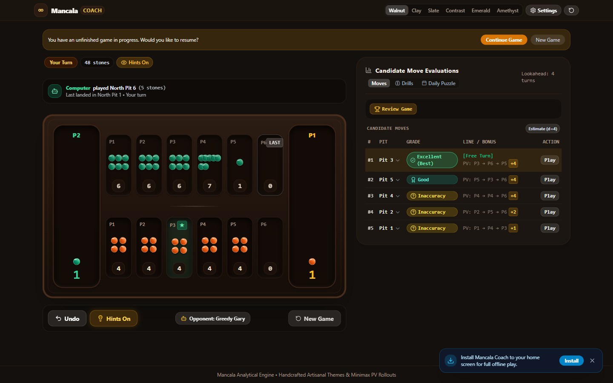
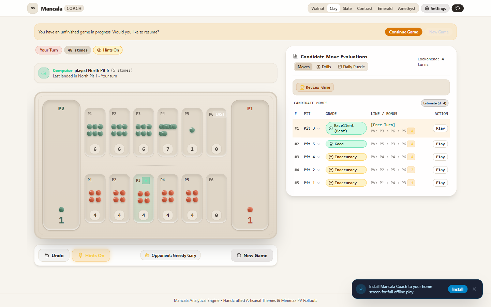
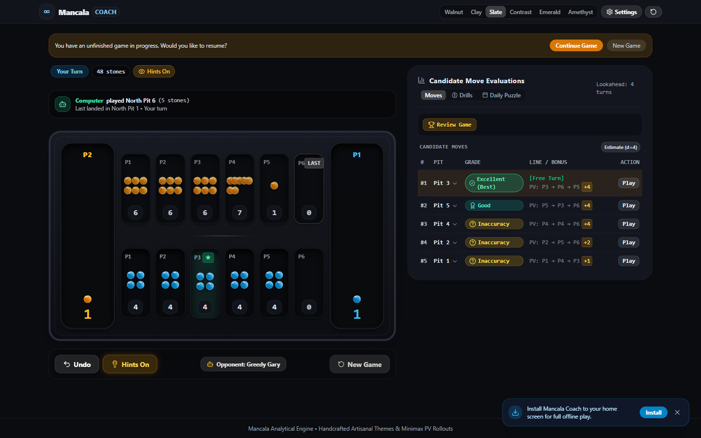
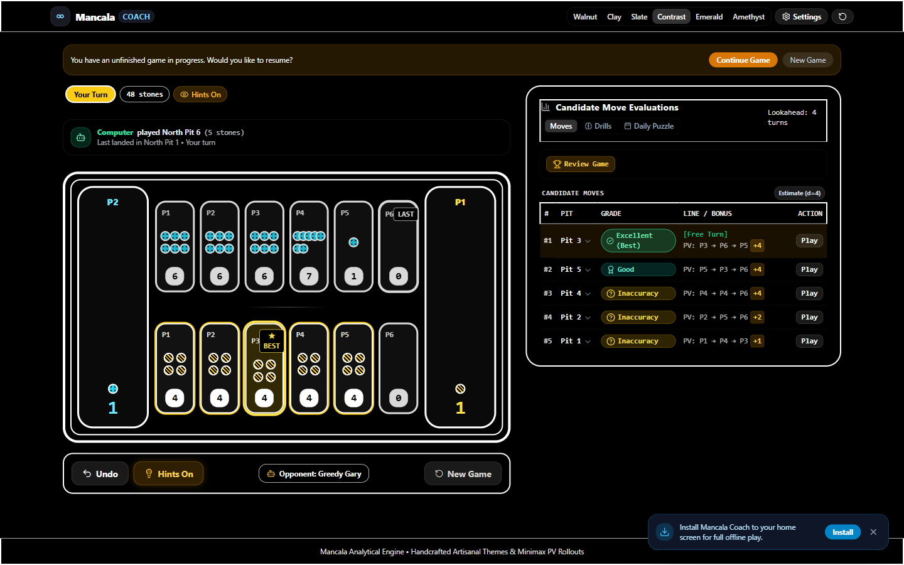
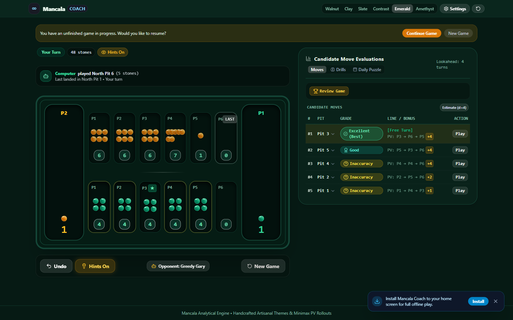
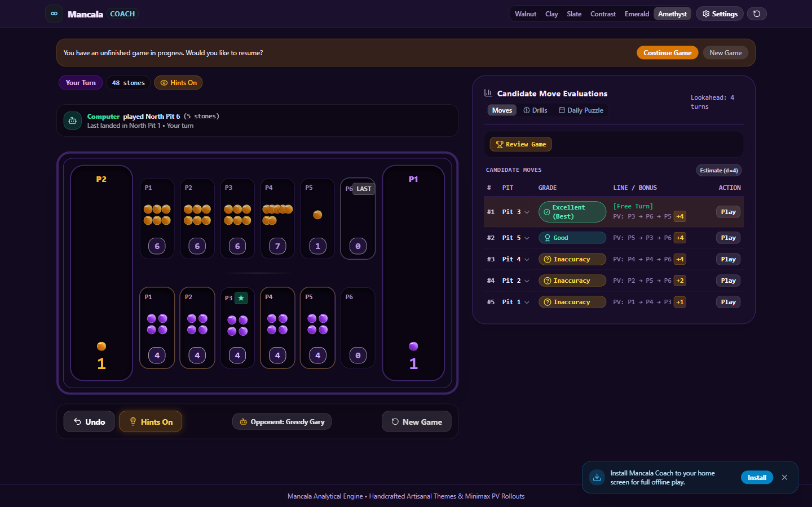
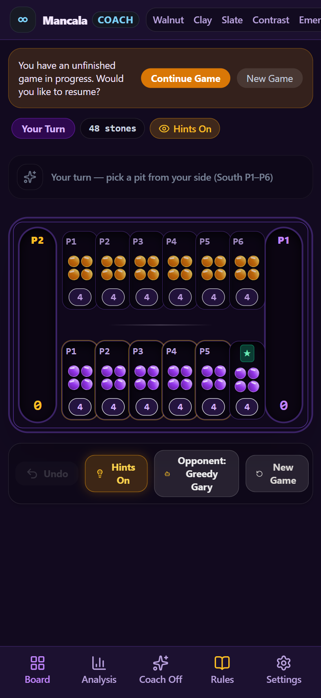

# Mancala Coach

A modern analytical Mancala game and trainer inspired by GNU Backgammon. Play casually with a pure tactile board, or turn on deep analytical overlays to elevate your tactical foresight. Runs entirely inside modern browsers with zero tracking, zero accounts, and complete offline PWA capability.

## Visual Themes

Mancala Coach features six handcrafted themes engineered for distinct sensory environments and accessibility standards.

### Walnut
Warm carnelian and mountain jade pebbles resting in carved hardwood with brass trim.



### Clay
Scandinavian stoneware ceramic theme with terracotta and sage stones.



### Slate
Deep graphite dark theme with sapphire crystal and topaz quartz gemstones.



### Contrast
Tactile accessibility theme engineered for WCAG AAA compliance, featuring diagonal striped South stones and stippled North stones.



### Emerald
Tournament felt presentation with nephrite jade and amber velvet.



### Amethyst
Royal purple velvet board accented with celestial gold gemstones.



### Mobile Experience
Engineered for handheld play with zero horizontal scrolling down to 360px viewport width, large tactile hit targets, and a fixed five item navigation tray.



## Core Capabilities

1. Deep Minimax Engine
Minimax search with alpha beta pruning and bounded transposition table. Evaluates all legal moves, classifies choices as Excellent, Good, Inaccuracy, Mistake, or Blunder, and calculates principal variation move rollouts.

2. Exact Endgame Solver
Negamax alpha beta solver with transposition table caching. When playable stones reach fourteen or fewer, positions solve to mathematical completion with exact stone margins and truthful win probabilities.

3. Truth First Evaluation
Positional evaluations frame advantage truthfully in terms of stones ahead rather than volatile percentages. Metric badges clearly distinguish exact mathematical solutions from heuristic depth estimates.

4. Deterministic Coach Explanations
Tactical coach warnings evaluate positions across ten deterministic strategic principles including tempo stalls, pocket captures, starvation counters, and free turn preservation.

5. Spaced Repetition Mistake Trainer
Interactive flashcard drill system utilizing Leitner box intervals to reinforce pattern recognition on previous blunders.

6. Offline Progressive Web App
Complete offline capability with service worker asset caching, installable web manifest, local storage persistence, and zero telemetry.

## Quick Start

Prerequisites: Node.js version 18 plus and npm.

```bash
git clone https://github.com/vjb/mymancala.git
cd mymancala
npm install
npm run dev
```

Run test suite:
```bash
npm test
```

Build production bundle:
```bash
npm run build
```

## Kalah Rules

1. Board Layout: Two rows of six playable pits with a dedicated store at each end.
2. Counter Clockwise Sowing: Pick up all stones from any pit on your side and deposit one stone into each subsequent pit counter clockwise, including your store while bypassing your opponent store.
3. Bonus Free Turn: When your final stone lands directly inside your store, you immediately receive a bonus move.
4. Opposite Capture: When your final stone lands in an empty pit on your side while the adjacent opposite pit holds stones, you capture all opponent stones plus your landing stone.
5. Game Termination: When all pits on one player side become vacant, remaining stones sweep into their owner store. The player with the highest store count wins.

## Repository Architecture

<table>
<tr><th>Path</th><th>Description</th></tr>
<tr><td>src/engine.ts</td><td>Minimax search, move simulation, evaluation, and grading</td></tr>
<tr><td>src/solver/endgame.ts</td><td>Negamax exact endgame solver with transposition table</td></tr>
<tr><td>src/rules/kalah.ts</td><td>Headless Kalah rule mechanics and board geometry invariants</td></tr>
<tr><td>src/rules/oware.ts</td><td>Academic Oware Abapa rules with grand slam protection</td></tr>
<tr><td>src/trainer/classify.ts</td><td>Five tier move classification and error rate calculations</td></tr>
<tr><td>src/trainer/explain.ts</td><td>Deterministic ten reason tactical explanation engine</td></tr>
<tr><td>src/trainer/mistakes.ts</td><td>Leitner box spaced repetition mistake memory storage</td></tr>
<tr><td>src/trainer/rating.ts</td><td>Local Elo rating ladder and rank tier titles</td></tr>
<tr><td>src/bots.ts</td><td>Calibrated bot personas, search depths, and tactical quotes</td></tr>
<tr><td>src/components/board/</td><td>Tactile board, pit buttons, store troughs, and highlights</td></tr>
<tr><td>src/components/panels/</td><td>Analysis tables, drill flashcards, and daily puzzles</td></tr>
<tr><td>src/components/shell/</td><td>Header, evaluation gauge, action bar, and bottom tray</td></tr>
<tr><td>src/theme.ts</td><td>Theme token definitions across all six artisanal palettes</td></tr>
<tr><td>src/sound.ts</td><td>Procedural audio synthesis using Web Audio API</td></tr>
</table>

## Quality Standards

1. Zero Layout Shift: Absolute dialogue positioning guarantees zero pixel board jump during gameplay.
2. Zero Viewport Scrolling: The desktop dashboard fits entirely within standard laptop viewports.
3. Mobile Guardrail: Strict zero horizontal scroll verified at 360px viewport width.
4. Accessibility: WCAG AAA high contrast skin with non color tactile pebble patterns.

## License

MIT
